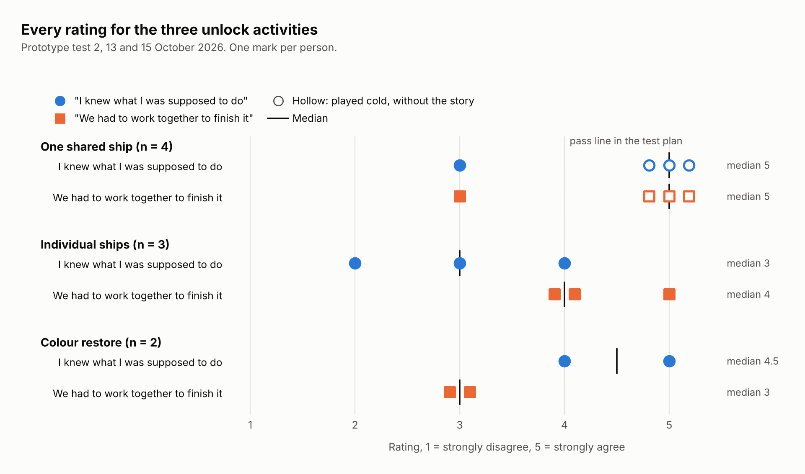

# User Testing

How the Space-Cap concept was tested and changed after the discovery interviews (see [`../research/interviews/`](../research/interviews/)). Interviews told us how people relate to memories; these rounds checked whether the prototype gets a group sharing and revealing them together. Three early concept and paper rounds (0 to 2, including the lo-fi chit activity) shaped the idea; the prototype itself then went through **three rounds of user testing**: prototype test 1, prototype test 2 and the Week 12 tradeshow ([`tradeshow-feedback/`](tradeshow-feedback/)).

## Summary

| Round | What we tested | Key finding | What changed |
|---|---|---|---|
| 0. Concept storyboards | Living Plant, Sealed Memory Pool, Cyclical Digital Time Capsule | Sealed drops + group reveal fit the interview themes best | Combined into a sealed, cyclical capsule with a collaborative reveal |
| 1. Puzzle reveal (photo) | Geoguessr-style photo reconstruction | Worked for photos but locked to one format | Broadened to "pieces coming together" for text and audio too |
| 2. Lo-fi chit activity | Writing anonymous trait-based notes about group members | People wrote more freely anonymously and were curious who each note was about | Became prompted anonymous submissions and the guess-who reveal |
| 3. Prototype test 1: v1 (3C model) | Memory Stars submission, Launch Sequence lobby, colouring puzzle reveal | Colouring puzzle confused testers; tutor said the reveal was passive | Reveal redesigned as a flash-card guessing game |
| 4. Prototype test 2 | Full flow end to end; colour game vs individual ships vs one shared ship | Shared ship most collaborative; the reveal was the strongest moment; unprompted contribution the weakest | Shared ship kept, colour game dropped; control labels and optional categories proposed |
| 5. Week 12 tradeshow | The final build in public, with peer feedback forms | The shared ship worked once facilitators said the controls were split; someone missing at the reveal was the biggest concern | Recorded in [`tradeshow-feedback/`](tradeshow-feedback/) |

---

## Round 0. Concept storyboards

Three concepts were storyboarded and compared against the experience requirements:

- **Living Plant (Memory Garden):** an already-alive plant the group keeps healthy by adding memories.
- **Sealed Memory Pool:** casual drops through the semester, nothing visible until a semester-end get-together where the pool unlocks as a group puzzle.
- **Cyclical Digital Time Capsule:** sign up, submit privately, seal, get a unique key, reconvene years later, solve a puzzle together, reveal, then start the next capsule.

**Decision:** the sealed pool and the cyclical capsule were merged. They match interview themes T2 (seal now, value later), T5 (build in the trigger) and T6 (peer group). Open questions noted at the time: how to seal media technically, what motivates a group to sign up (*to stay in touch*), and how the unlock should work.

## Round 1. Puzzle reveal

A teammate built and tested a Geoguessr-style photo mechanic. The idea became "putting the memory back together": each person gets a different piece (part of a photo, scrambled lines of a message, a clip of audio) and the memory only unlocks once the group combines them.

**Why:** it worked as an example but was locked to photos, which conflicts with T1 (people use different formats for different memories).

## Round 2. Lo-fi chit activity

A paper version of memory submission, run with a group in class. Each participant got chits labelled with a trait (e.g. *Critical*, *Fashionable*, *Creative*, *AI-Peasant*) and wrote something about the group member they most associated with that trait. The group then coloured in a line drawing together (traced from a photo of their water bottles) before the notes were handed over.

**What we learned:**
- People were more willing to write openly when it was anonymous.
- The fun came afterwards: everyone wanted to know what had been written about them and who it was about.
- The colouring step confused people: it had nothing to do with the notes it was meant to unlock.

**What changed:** this activity became the basis of the final prototype. The trait chits turned into prompted, anonymous memory submissions ("finish the sentence about a crewmate"), and the curiosity about who wrote what fed directly into the flash-card reveal, where the group guesses who each memory is about. The colouring unlock was carried into prototype v1 anyway, and failed again there (Round 3).

**Link to interviews:** T7 (prompts unlock reflection people wouldn't do unprompted) and T3 (people filter what they share, so anonymity makes sharing feel safe).

## Round 3. Prototype test 1: v1

Prototype v1 was organised around the 3C model:

- **Communication:** Memory Stars, where each star is a prompted memory submission.
- **Coordination:** Launch Sequence lobby with a QR join code and live crew status (who has submitted).
- **Cooperation / collaboration:** colours assigned to each person, a group colouring activity to unlock the reveal.

### Findings

- **Users:** testers didn't understand why a colouring puzzle unlocked a memory. The link between "colouring a photo together" and "unlocking a memory" didn't land.
- **Tutor:** the reveal needed to be more interactive. All memories appeared at once, so the group watched rather than took part.

### Response: flash-card guessing game

- Each memory prompt is shown one at a time with the name blanked out (*"When ___ says 5 mins, they mean 10,000 years"*).
- The group guesses who it's about; a light leaderboard tracks correct guesses.
- This turns the reveal from something people watch into something they play. It follows Olsson et al.'s finding that engaging people in collective activity works better than simply increasing awareness.

Paper prototype of the flash-card reveal:

| Card face-down / prompt shown | Guessing with leaderboard |
|---|---|
|  |  |

Still open after this round: whether to keep the colouring puzzle alongside the flash cards, replace it, or move it to the sealing phase. Only one small group had tested, so findings were preliminary.

## Round 4. Prototype test 2: full flow and unlock comparison

The merged build, tested end to end before the tradeshow. A testing plan set out five assumptions with a pass test for each, written down before the sessions so the results couldn't be argued afterwards. Every participant filled in a Google Form at the end (16 statements rated 1 to 5, plus one word for how the activity felt), and an observer took notes.

- **Participants:** 9, in three crews of three · **Dates:** 13 and 15 October 2026
- **Sessions:** two full runs (join, collect, launch, unlock, reveal) and one activities-only session, played without the story around it

### Unlock activities compared

| Activity | "I knew what I was supposed to do" | "We had to work together to finish it" | One word |
|---|---|---|---|
| One shared ship (4 people) | 5, 5, 5, 3 | 5, 5, 5, 3 | Fun, Cooperation, Fun, Fun but confusing |
| Individual ships (3 people) | 4, 3, 2 | 4, 4, 5 | Wholesome, Fun, I love it, its fun |
| Colour restore (2 people) | 5, 4 | 3, 3 | Nostalgic, fun! |

- **Colour restore:** easy to understand but not collaborative, below the pass line on working together. Dropped.
- **Individual ships:** collaborative but confusing. It felt like playing alone with others nearby.
- **One shared ship:** chosen. Players talked throughout (*"left, left, left"*, *"who has the gun?"*). Three of its four top ratings came from the crew that played it cold, and the one person who played it after the full story rated it 3, so the ratings alone don't settle it. The talk during play and the tradeshow response back it up.

### Five assumptions

Writing, reveal and phone ratings are from the six people who wrote memories and opened their own capsule. The activities-only crew never did either.

| Assumption | Pass test | Result |
|---|---|---|
| A1. People add memories without being asked | Median 4+ on "If this crew were real, I would add something next week without a reminder" | Median 3. **Not supported** |
| A2. The prompts are clearly about crewmates | 4 of 5 rate "I knew straight away who the memories were meant to be about" 4+ | 5 of 6. **Supported on the ratings** |
| A3. The unlock is collaborative and tied to the memories | "We had to work together to finish it" 4+ | Shared ship median 5. **Supported**, but players didn't always know what they were collecting or why |
| A4. The reveal is worth the wait | "Opening it was worth the wait" 4+ | Median 4, and 5 of 6 learnt something about how their crewmates see them. **Supported on the ratings** |
| A5. Having it on your own phone matters | "Having this on my own phone, rather than the group sharing one screen, made it better" 4+ | Median 4, but "Doing this on a phone felt natural rather than awkward" had a median of 3. **Mixed** |

### What participants told us

- **Joining:** simulated crewmates filled the crew and blocked a real participant; crew codes were spelled out letter by letter; the briefing scrolled too fast to read.
- **Collecting:** it wasn't clear which capsules were yours to fill; three required memory categories felt like too much; people wanted to keep adding after launch, and a camera for a group selfie.
- **Privacy:** one participant expected memories to be anonymous and was uncomfortable that authorship showed; others raised consent for photos of people who hadn't agreed.
- **Space game:** nobody realised the five controls were split until told; they asked to see who holds which control so they'd know who to talk to.
- **What worked:** fun once the flow made sense; the rocket launch, the jump to 2050 and the shooting game drew the strongest reactions.

**What changed:** the shared ship was kept for the tradeshow and the colour game dropped. Proposed fixes: show who holds each control on screen, make memory categories optional, slow the briefing down. Anonymity was recorded as an ethical tension rather than adopted, since it removes accountability for unkind entries.

**Link to interviews:** T7 (prompts unlock reflection): five of six knew straight away the prompts were about crewmates. T6 (audience in the middle, a peer group): the shared ship makes every crew member a contributor, and the reveal's strongest result was learning how crewmates see you. T3 (curation is action-driven): only two of six would add a memory the next week unprompted, so collection needs low-effort triggers, and required categories work against it. T1 (medium matches the memory): people asked for voice and camera, not just text.

## Exhibition-ready flow

Join the crew via QR → submit prompted memories (finish the sentence about a crewmate, group selfie, DECO studio prompts) → load capsules into the rocket → launch together → years later, a reunion notification (*"24 years since DECO3500"*) → co-op space game to recover the capsules → *"the capsule is open"*: flash-card reveal.

## Evaluation lenses

The final prototype was evaluated against five lenses: social objective (Olsson et al.), collaboration (3C model and awareness), context (time and space), social consequences (Grudin) and time (repeated or long-term use). It is a same-time, different-or-same-place experience: memories are submitted asynchronously, then experienced together synchronously.

## Interview themes after testing

| Interview theme | Held up? | What testing added |
|---|---|---|
| T1 Emotional register / formats | Yes | Reveal must work for text and audio, not just photos |
| T2 Seal now, value later | Yes | Still the core assumption; long-term follow-through untested (Rumsfeld: unknown unknown) |
| T5 Revisiting is triggered | Yes | A trigger alone isn't enough; the reveal must be active, not passive |
| T6 Peer audience | Yes | Shared controls make everyone a contributor |
| T7 Prompts unlock reflection | Yes | Prompts double as reveal content in the guessing game |
