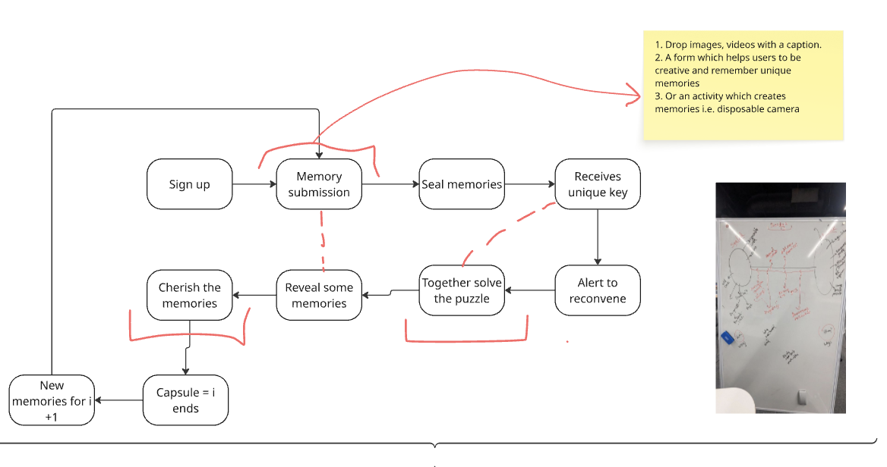
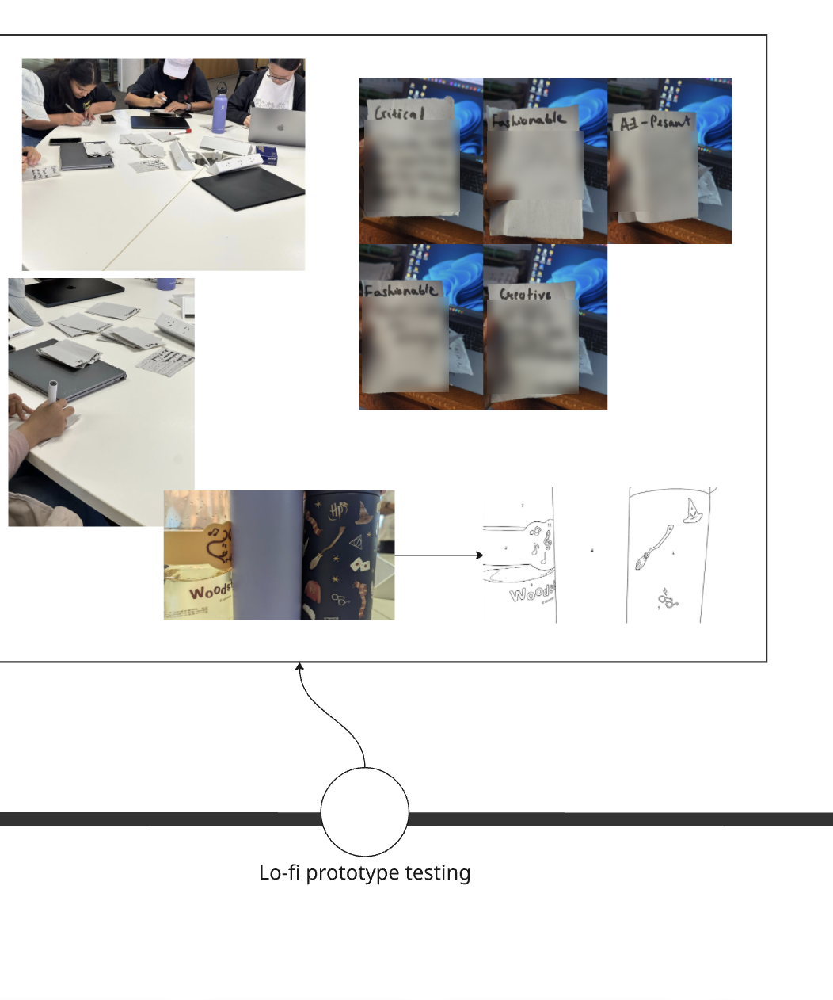

# User Testing

How the Space-Cap concept was tested and changed after the discovery interviews (see [`../research/interviews/`](../research/interviews/)). Interviews told us how people relate to memories; these rounds checked whether the prototype gets a group sharing and revealing them together. Three early concept and paper rounds (0–2) shaped the idea; the prototype itself was then tested in **two formal rounds** (prototype tests 1 and 2), followed by the Week 12 tradeshow ([`tradeshow-feedback/`](tradeshow-feedback/)).

## Summary

| Round | What we tested | Key finding | What changed |
|---|---|---|---|
| 0. Concept storyboards | Living Plant, Sealed Memory Pool, Cyclical Digital Time Capsule | Sealed drops + group reveal fit the interview themes best | Combined into a sealed, cyclical capsule with a collaborative reveal |
| 1. Puzzle reveal (photo) | Geoguessr-style photo reconstruction | Worked for photos but locked to one format | Broadened to "pieces coming together" for text and audio too |
| 2. Lo-fi chit activity | Writing anonymous trait-based notes about group members | People wrote more freely anonymously and were curious who each note was about | Became prompted anonymous submissions and the guess-who reveal |
| 3. Prototype test 1: v1 (3C model) | Memory Stars submission, Launch Sequence lobby, colouring puzzle reveal | Colouring puzzle confused testers; tutor said the reveal was passive | Reveal redesigned as a flash-card guessing game |
| 4. Prototype test 2: unlock activities | Colour restore vs individual ships vs one shared ship | The shared ship was both the clearest and the most collaborative | Final game is one ship with steering, throttle, altitude, pick-up and the gun split across the crew |

---

## Round 0. Concept storyboards

Three concepts were storyboarded and compared against the experience requirements:

- **Living Plant (Memory Garden):** an already-alive plant the group keeps healthy by adding memories.
- **Sealed Memory Pool:** casual drops through the semester, nothing visible until a semester-end get-together where the pool unlocks as a group puzzle.
- **Cyclical Digital Time Capsule:** sign up, submit privately, seal, get a unique key, reconvene years later, solve a puzzle together, reveal, then start the next capsule.

**Decision:** the sealed pool and the cyclical capsule were merged. They match interview themes T2 (seal now, value later), T5 (build in the trigger) and T6 (peer group). Open questions noted at the time: how to seal media technically, what motivates a group to sign up (*to stay in touch*), and how the unlock should work.

## Round 1. Puzzle reveal

A teammate built and tested a Geoguessr-style photo mechanic. The idea became "putting the memory back together": each person gets a different piece (part of a photo, scrambled lines of a message, a clip of audio) and the memory only unlocks once the group combines them.

**Why:** it worked as an example but was locked to photos, which conflicts with T1 (people use different formats for different memories).

## Round 2. Lo-fi chit activity

A paper version of memory submission, run with a group in class. Each participant got chits labelled with a trait (e.g. *Critical*, *Fashionable*, *Creative*, *AI-Peasant*) and wrote something about the group member they most associated with that trait.

**What we learned:**
- People were more willing to write openly when it was anonymous.
- The fun came afterwards: everyone wanted to know what had been written about them and who it was about.

**What changed:** this activity became the basis of the final prototype. The trait chits turned into prompted, anonymous memory submissions ("finish the sentence about a crewmate"), and the curiosity about who wrote what fed directly into the flash-card reveal, where the group guesses who each memory is about.

**Link to interviews:** T7 (prompts unlock reflection people wouldn't do unprompted) and T3 (people filter what they share, so anonymity makes sharing feel safe).

## Round 3. Prototype test 1: v1

Prototype v1 was organised around the 3C model:

- **Communication:** Memory Stars, where each star is a prompted memory submission.
- **Coordination:** Launch Sequence lobby with a QR join code and live crew status (who has submitted).
- **Cooperation / collaboration:** colours assigned to each person, a group colouring activity to unlock the reveal.

### Findings

- **Users:** testers didn't understand why a colouring puzzle unlocked a memory. The link between "colouring a photo together" and "unlocking a memory" didn't land.
- **Tutor:** the reveal needed to be more interactive. All memories appeared at once, so the group watched rather than took part.

### Response: flash-card guessing game

- Each memory prompt is shown one at a time with the name blanked out (*"When ___ says 5 mins, they mean 10,000 years"*).
- The group guesses who it's about; a light leaderboard tracks correct guesses.
- This turns the reveal from something people watch into something they play. It follows Olsson et al.'s finding that engaging people in collective activity works better than simply increasing awareness.

Paper prototype of the flash-card reveal:

| Card face-down / prompt shown | Guessing with leaderboard |
|---|---|
|  |  |

Still open after this round: whether to keep the colouring puzzle alongside the flash cards, replace it, or move it to the sealing phase. Only one small group had tested, so findings were preliminary.

## Round 4. Prototype test 2: comparing three unlock activities

- **Participants:** 9, across two sessions · **Dates:** 13 and 15 October 2026
- **Colour restore:** each player recreates a campus colour from memory; the crew average restores the memories.
- **Individual ships:** each player has their own ship and controls, with a shared goal.
- **One shared ship:** a single spacecraft, with steering, throttle, altitude, memory pick-up and the gun split between crew members, so nobody can fly it alone.

| Activity | "I knew what to do" | "We had to work together" |
| --- | --- | --- |
| One shared ship | 4.5 | 4.5 |
| Individual ships | 3.0 | 4.3 |
| Colour restore | 4.5 | 3.0 |

- **Result:** the shared ship scored highest on both. Individual ships confused people because each player assumed they were flying alone; colour restore was easy to understand but the least collaborative. We went with the shared ship, framed as design by subtraction. Full reasoning in [decision 0004](../docs/decisions/0004-shared-ship-unlock.md).

**Link to interviews:** T6 (memories as glue for a peer group). Shared controls make every member a contributor rather than a spectator.

## Exhibition-ready flow

Join the crew via QR → submit prompted memories (finish the sentence about a crewmate, group selfie, DECO studio prompts) → load capsules into the rocket → launch together → years later, a reunion notification (*"24 years since DECO3500"*) → co-op space game to recover the capsules → *"the capsule is open"*: flash-card reveal.

## Evaluation lenses

The final prototype was evaluated against five lenses: social objective (Olsson et al.), collaboration (3C model and awareness), context (time and space), social consequences (Grudin) and time (repeated or long-term use). It is a same-time, different-or-same-place experience: memories are submitted asynchronously, then experienced together synchronously.

## Interview themes after testing

| Interview theme | Held up? | What testing added |
|---|---|---|
| T1 Emotional register / formats | Yes | Reveal must work for text and audio, not just photos |
| T2 Seal now, value later | Yes | Still the core assumption; long-term follow-through untested (Rumsfeld: unknown unknown) |
| T5 Revisiting is triggered | Yes | A trigger alone isn't enough; the reveal must be active, not passive |
| T6 Peer audience | Yes | Shared controls make everyone a contributor |
| T7 Prompts unlock reflection | Yes | Prompts double as reveal content in the guessing game |
